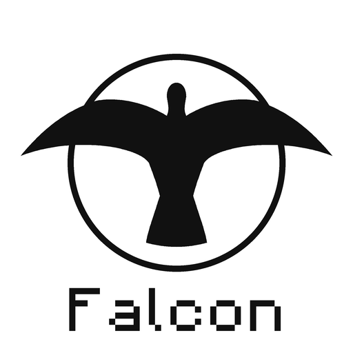

<p align="center">
	<picture>
		<source media="(prefers-color-scheme: dark)" srcset="https://raw.githubusercontent.com/Falcon-MC/Falcon/main/.github/logo-white.png">
		
	</picture>
	<br>
	<b>Falcon Network</b>
	<br>
	Minecraft: Bedrock Edition transport layer written in C++17
</p>

<p align="center">
	
	
	
</p>

## What is this?

Everything between the socket and a decoded Bedrock packet. It is the transport layer of
[Falcon](https://github.com/Falcon-MC/Falcon) and builds on top of
[Falcon.Protocol](../Falcon.Protocol).

- **RakNet** - own implementation of the peer, sockets, bit stream, reliability layer and connection
  handshake
- **NetherNet** - WebRTC transport through libdatachannel, with the signaling server and LAN
  discovery
- **Peers** - batching and compression layers stacked on top of the raw transport, behind a common
  `NetworkPeer` interface
- **Connection requests** - parsing of the client login JWT (identity, skin, device)
- **Server locator** - the pong data advertised to the server list

## Usage

The library is a plain CMake target named `FalconNetwork`, part of the
[Falcon](https://github.com/Falcon-MC/Falcon) repository. Falcon builds it with
`add_subdirectory(Falcon.Network)`; on its own it builds [Falcon.Protocol](../Falcon.Protocol) from the
folder next to it and fetches libdatachannel. Another project can take it from the Falcon repository:

```cmake
include(FetchContent)

FetchContent_Declare(
    falcon
    GIT_REPOSITORY https://github.com/Falcon-MC/Falcon.git
    GIT_TAG dev
    GIT_SHALLOW TRUE
    SOURCE_SUBDIR Falcon.Network
)
FetchContent_MakeAvailable(falcon)

target_link_libraries(your_target PRIVATE FalconNetwork)
```

## Building

Requires CMake 3.16+, a C++17 compiler, zlib and OpenSSL. The first configure needs network access to
fetch the dependencies. From this folder:

```
cmake -B build -G Ninja
cmake --build build
```

## Related folders and repositories

- [Falcon.Server](../Falcon.Server) - the server
- [Falcon.Protocol](../Falcon.Protocol) - packets and network types
- [NBT](https://github.com/Falcon-MC/NBT) - NBT tags and binary streams
- [BedrockData](https://github.com/Falcon-MC/BedrockData) - game data files, versioned by protocol

## Licensing information

Falcon Network is licensed under the [GNU Lesser General Public License v3.0](../LICENSE), which supplements
the [GNU General Public License v3.0](../COPYING). It can be linked from projects under any license, as long as
changes to this library itself stay under the same license.

Falcon is not affiliated with Mojang. All brands and trademarks belong to their respective owners.
