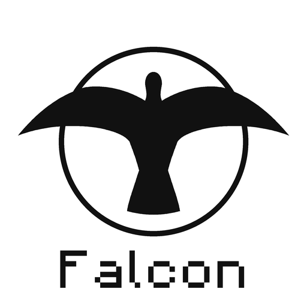

<p align="center">
	<picture>
		<source media="(prefers-color-scheme: dark)" srcset="https://raw.githubusercontent.com/Falcon-MC/Falcon/main/.github/logo-white.png">
		
	</picture>
	<br>
	<b>Falcon Protocol</b>
	<br>
	Minecraft: Bedrock Edition protocol library written in C++17
</p>

<p align="center">
	
	
	
</p>

## What is this?

The binary format of the Bedrock protocol, with no game logic attached. It is the lowest layer of
[Falcon](https://github.com/Falcon-MC/Falcon) and has no dependency on the server or the transport.

- **Packets** - one class per Bedrock packet in `Protocol/Packets`, each with `write`, `read` and a
  typed `handle` dispatch through `NetworkPacketHandler`
- **Packet ids and factory** - `MinecraftPacketIds` and `MinecraftPackets` create a packet from its id
- **Network types** - items, block definitions, inventory sources, commands, camera, attributes and
  more in `Protocol/Types`
- **Codecs** - items (inventory and entity formats), entity metadata, skins, inventory transactions,
  camera and data store
NBT, binary streams, the JSON parser, math types and logging come from [Falcon.Shared](../Falcon.Shared), built
from the folder next to this one.

## Usage

The library is a plain CMake target named `FalconProtocol`, part of the
[Falcon](https://github.com/Falcon-MC/Falcon) repository. Falcon builds it with
`add_subdirectory(Falcon.Protocol)`. Another project can take it from the Falcon repository:

```cmake
include(FetchContent)

FetchContent_Declare(
    falcon
    GIT_REPOSITORY https://github.com/Falcon-MC/Falcon.git
    GIT_TAG dev
    GIT_SHALLOW TRUE
    SOURCE_SUBDIR Falcon.Protocol
)
FetchContent_MakeAvailable(falcon)

target_link_libraries(your_target PRIVATE FalconProtocol)
```

## Building

Only CMake 3.16+ and a C++17 compiler are required. From this folder:

```
cmake -B build -G Ninja
cmake --build build
```

## Related folders and repositories

- [Falcon.Server](../Falcon.Server) - the server
- [Falcon.Network](../Falcon.Network) - RakNet and NetherNet transport
- [Falcon.Shared](../Falcon.Shared) - NBT, binary streams, JSON, math and logging
- [BedrockData](https://github.com/Falcon-MC/BedrockData) - game data files, versioned by protocol

## Licensing information

Falcon Protocol is licensed under the [GNU Lesser General Public License v3.0](../LICENSE), which supplements
the [GNU General Public License v3.0](../COPYING). It can be linked from projects under any license, as long as
changes to this library itself stay under the same license.

Falcon is not affiliated with Mojang. All brands and trademarks belong to their respective owners.
