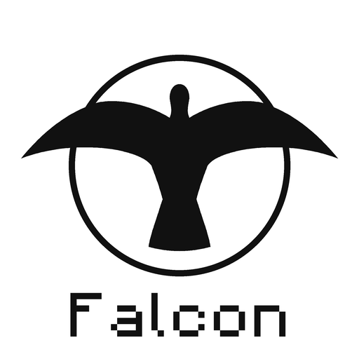

<p align="center">
	<picture>
		<source media="(prefers-color-scheme: dark)" srcset="https://raw.githubusercontent.com/Falcon-MC/Falcon/main/.github/logo-white.png">
		
	</picture>
	<br>
	<b>Falcon Shared</b>
	<br>
	The base library of Falcon: NBT, binary streams, JSON, math and logging, written in C++17
</p>

<p align="center">
	
</p>

## What is this?

The code shared by every layer of [Falcon](https://github.com/Falcon-MC/Falcon): the protocol, the transport
and the server all build on it, and it depends on none of them.

- **`Tag`** - a single NBT value of any of the 13 tag types. Compounds keep their insertion order.
- **`NbtIo`** - reads and writes tags in three encodings selected with `NbtVariant`:
  - `BigEndian` - Java Edition layout
  - `LittleEndian` - Bedrock world storage and `.dat` files
  - `Network` - Bedrock packets: ints and longs are zigzag varints, strings and the root name use an unsigned
    varint length, every array and list length is a zigzag varint
- **`BinaryStream` / `ReadOnlyBinaryStream`** - the byte buffer the codecs read from and write to, with
  `EncodingSettings` limits (maximum list size, byte array size and string length) for untrusted input
- **`json::Value`** - the JSON parser shared by the libraries that depend on this one
- **Math** - vectors, bounding boxes and constants in `Core/Math`
- **Logging** - `BedrockLog` and its file and content log end points in `Core/Debug`

Nesting is limited to `NbtIo::MAX_DEPTH` (16) levels below the root on both read and write.

## Usage

The library is a plain CMake target named `FalconShared`, part of the Falcon repository. Falcon builds it
with `add_subdirectory(Falcon.Shared)`. Another project can take it from the Falcon repository:

```cmake
include(FetchContent)

FetchContent_Declare(
    falcon
    GIT_REPOSITORY https://github.com/Falcon-MC/Falcon.git
    GIT_TAG dev
    GIT_SHALLOW TRUE
    SOURCE_SUBDIR Falcon.Shared
)
FetchContent_MakeAvailable(falcon)

target_link_libraries(your_target PRIVATE FalconShared)
```

```cpp
#include "Core/NBT/NbtIo.h"

Tag state = Tag::ofCompound();
state.putString("name", "minecraft:stone");
state.put("states", Tag::ofCompound());

BinaryStream stream;
NbtIo::writeTag(stream, state, NbtVariant::LittleEndian);

ReadOnlyBinaryStream input(stream.getBuffer());
Tag decoded = NbtIo::readTag(input, NbtVariant::LittleEndian);
```

## Building

Only CMake 3.16+ and a C++17 compiler are required. From this folder, tests are built when the project is
the top level project (`FALCON_SHARED_BUILD_TESTS`).

```
cmake -B build -G Ninja
cmake --build build
ctest --test-dir build --output-on-failure
```

## License

LGPL-3.0, see [LICENSE](../LICENSE) and [COPYING](../COPYING).
