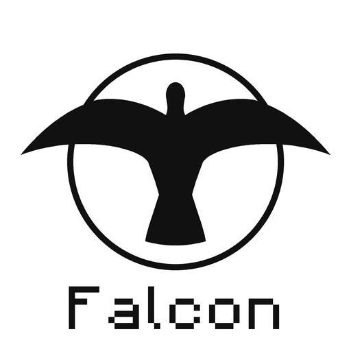

<p align="center">
	<picture>
		<source media="(prefers-color-scheme: dark)" srcset=".github/logo-white.png">
		
	</picture>
	<br>
	<b>Minecraft: Bedrock Edition server software written from scratch in C++</b>
	<br>
	Not affiliated with Mojang AB.
</p>

<p align="center">
	<a href="https://falcon-mc.github.io"></a>
	<a href="https://github.com/Falcon-MC/Falcon/actions/workflows/ci.yml"></a>
	
	
	
	
</p>

## What is this?

Falcon is a Minecraft: Bedrock Edition server written from scratch in C++17. Protocol, world storage,
inventories, movement and gameplay are reimplemented by hand, with vanilla behavior as the reference.

- **Native** - one self-contained executable, no runtime to install
- **Vanilla worlds** - the game's world format, including worlds from before 0.9
- **Behavior packs** - custom content and the official JavaScript scripting API
- **Plugins** - WebAssembly, native C and Java

## Getting started

Download the build for your system from the [releases](https://github.com/Falcon-MC/Falcon/releases), check it
against its `.sha256` file and run it. On the first start, a setup wizard writes `server.properties`.

Every setting is described on the [website](https://falcon-mc.github.io).

## Supported versions

Falcon speaks Minecraft **1.26.60** (protocol 2225). 1.26.52, 1.26.45 and 1.26.40 can join with
`any-version=true`.

## Plugins

| Runtime  | Use it for                                                    |
|----------|---------------------------------------------------------------|
| `wasm`   | New plugins, sandboxed, in any language with WIT bindings     |
| `native` | Raw performance through the C API                             |
| `java`   | Java plugins                                                  |

The API lives in [PluginAPI](https://github.com/Falcon-MC/PluginAPI), with a complete
[example](https://github.com/Falcon-MC/PluginAPI/tree/main/examples/wasm/HelloWasm).

## Privacy

To tell the game's client from unofficial ones, the server asks `api.falcon-mc.workers.dev` about each NetherNet
connection. It sends no player name, identifier or address. `allow-unofficial-clients=true` turns this off.
Telemetry is off unless you set `emit-server-telemetry=true`, and it names no server, world or player.

## Building

You need CMake 3.16+, a C++17 compiler, zlib and OpenSSL. On Windows, use MSYS2 UCRT64.

```
cmake -B build -G Ninja
cmake --build build
```

Protocol, transport, NBT and game data live in their own repositories under
[Falcon-MC](https://github.com/Falcon-MC).

## Contributing

Pull requests are welcome. Read [CONTRIBUTING.md](CONTRIBUTING.md) first, and report vulnerabilities as
[SECURITY.md](SECURITY.md) describes.

[](https://github.com/Falcon-MC/Falcon/graphs/contributors)

## License

Falcon is licensed under the [GNU LGPL v3.0](LICENSE), which supplements the [GNU GPL v3.0](COPYING).
Falcon is not affiliated with or approved by Mojang. All trademarks belong to their owners.
